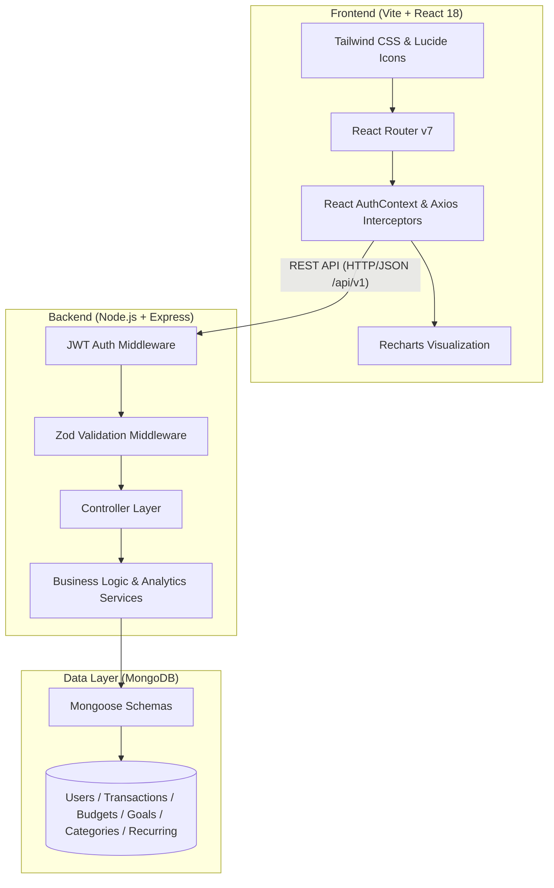

# 💰 FinTrack 360 - Personal Finance Management System

<div align="center">


**A modern, production-grade personal finance and wealth management platform built on the MERN stack.**  
*Engineered specifically for salaried professionals, freelancers, and household budget planners.*

[](https://www.mongodb.com/mern-stack)
[](https://reactjs.org/)
[](https://nodejs.org/)
[](https://www.mongodb.com/)
[](https://tailwindcss.com/)
[](https://zod.dev/)
[](LICENSE)

[Features](#-key-features) • [Architecture](#-system-architecture) • [Tech Stack](#-technology-stack) • [Quick Start](#-getting-started) • [API Docs](#-api-reference) • [Configuration](#-environment-variables)

</div>

---

## 🌟 Overview

**FinTrack 360** is a full-featured personal finance application designed to eliminate spreadsheet chaos and bring crystal-clear visibility to your financial health. By unifying income and expense tracking, category budgeting, recurring subscriptions, goal-oriented savings, and analytical cash flow visualizations into a single intuitive dashboard, FinTrack 360 empowers users to build sustainable financial habits.

### Why FinTrack 360?

- ⚡ **Zero Friction**: Fast, responsive single-page application built with React 18, Vite, and Tailwind CSS.
- 🔒 **Enterprise-Grade Security**: Stateless JWT authentication, bcrypt password hashing, data scoping per user, and strict Zod runtime schema validations on both client and server.
- 📊 **Actionable Analytics**: Real-time spending breakdowns, multi-month trends, and budget variance powered by interactive Recharts.
- 🎯 **Goal & Habit Focused**: Automated recurring payment detection, proactive budget overrun alerts, and visual savings milestone tracking.

---

## 🚀 Key Features

| Feature | Description |
| :--- | :--- |
| **📊 Executive Dashboard** | Real-time overview of monthly income, expenditures, net cash flow, savings rate gauge, active budget alerts, and recent transactions. |
| **💸 Transaction Ledger** | Record, update, and categorize income/expenses with rich metadata (payment methods, custom tags, date, notes). Includes instant search, multi-filter queries, and server-side pagination. |
| **🏷️ Custom Categories** | Dynamic category management with custom icons, color palettes, and income/expense classification alongside pre-configured system defaults. |
| **🎯 Smart Budgets & Overrun Alerts** | Allocate monthly spending limits per category. Visual progress bars calculate percentage used and trigger warning badges when thresholds (e.g., 80% or 100%) are breached. |
| **🏆 Savings Goals & Milestones** | Create dedicated savings targets (e.g., Emergency Fund, Vacation, Home Down Payment). Log contributions with live target date and percentage recalculations. |
| **🔄 Recurring Subscriptions & Bills** | Track scheduled recurring payments (Daily, Weekly, Monthly, Yearly). Supports auto-processing of due transactions, pause/resume controls, and upcoming payment warnings. |
| **📈 Deep Financial Analytics** | 6-month historical cash flow trends, category-wise expenditure pie/donut charts, and budget performance analytics with date-picker flexibility. |
| **⚙️ Profile & Preferences** | Manage user credentials, update passwords securely, and toggle preferred fiat currencies (`USD`, `EUR`, `GBP`, `INR`, `CAD`, `AUD`). |

---

## 🏗️ System Architecture



### Directory Structure

```text
FinTrack 360/
├── client/                              # Frontend React Single Page Application
│   ├── public/                          # Static assets and favicon
│   ├── src/
│   │   ├── components/                  # Modular UI components
│   │   │   ├── analytics/               # Trends, charts & budget performance cards
│   │   │   ├── auth/                    # ProtectedRoute, Auth forms
│   │   │   ├── budgets/                 # Budget progress list & budget modals
│   │   │   ├── categories/              # Category cards & category form modals
│   │   │   ├── common/                  # Navbar, Sidebar, Card, Button, Modal, StatCard
│   │   │   ├── goals/                   # Goal cards, target progress & contribution modal
│   │   │   ├── layout/                  # MainLayout & page scaffolds
│   │   │   ├── recurring/               # Recurring schedules table & form modals
│   │   │   └── transactions/            # Filters, forms, tables & transaction modals
│   │   ├── context/                     # AuthContext (JWT management & session state)
│   │   ├── pages/                       # Route views (Dashboard, Transactions, Budgets, etc.)
│   │   ├── routes/                      # AppRouter definition with protected sub-routes
│   │   ├── services/                    # Axios API service clients
│   │   └── utils/                       # Currency/date formatters, validators & constants
│   ├── index.html                       # HTML5 entry template
│   ├── tailwind.config.js               # Tailwind CSS theme configuration
│   └── vite.config.js                   # Vite bundler & dev server config
│
├── server/                              # Backend Express REST API Application
│   ├── src/
│   │   ├── config/                      # Database connection (Mongoose)
│   │   ├── controllers/                 # Express route handlers
│   │   ├── middlewares/                 # Auth verification, error handling & Zod middleware
│   │   ├── models/                      # MongoDB/Mongoose data schemas
│   │   │   ├── Budget.js                # Monthly spending limits
│   │   │   ├── Category.js              # User & system categories
│   │   │   ├── Goal.js                  # Savings targets & milestone history
│   │   │   ├── RecurringTransaction.js  # Scheduled subscriptions & rules
│   │   │   ├── Transaction.js           # Core income/expense records
│   │   │   └── User.js                  # User profile with password hashing
│   │   ├── routes/                      # Versioned API routes (/api/v1/*)
│   │   ├── services/                    # Domain logic & analytics aggregations
│   │   ├── utils/                       # ApiError, ApiResponse & Logger wrappers
│   │   ├── validators/                  # Zod request validation schemas
│   │   ├── app.js                       # Express app assembly & middleware stack
│   │   └── server.js                    # Server bootstrap & listener
│   └── package.json
│
├── package.json                         # Root package manager & orchestration scripts
├── .gitignore                           # Git ignore rules
└── README.md                            # Project documentation
```

---

## 🛠️ Technology Stack

### Frontend

| Technology | Purpose |
| :--- | :--- |
| **React 18** | UI component architecture and reactive state management |
| **Vite 6** | Ultra-fast build tool and modern local development server |
| **React Router v7** | Declarative client-side routing and protected navigation |
| **Tailwind CSS v3** | Modern utility-first CSS styling and dark-mode design system |
| **Lucide React** | Consistent, modern iconography |
| **Recharts** | Composable charting library for financial trends and breakdowns |
| **Axios** | HTTP client with automatic JWT bearer token injection |
| **React Hook Form + Zod** | Type-safe form validation and state handling |

### Backend

| Technology | Purpose |
| :--- | :--- |
| **Node.js** | Scalable, event-driven JavaScript runtime |
| **Express.js 4** | Robust RESTful API routing and middleware framework |
| **MongoDB & Mongoose 8** | Flexible document database with schema validation and indexing |
| **JSON Web Tokens (JWT)** | Stateless authentication with signed authorization tokens |
| **Bcrypt.js** | Salted password hashing for credentials protection |
| **Zod** | Schema definition and runtime API request validation |
| **Morgan & CORS** | HTTP request logging and cross-origin resource sharing |

---

## ⚡ Getting Started

### Prerequisites

Ensure you have the following installed on your machine:
- **Node.js**: `v18.0.0` or higher ([Download Node.js](https://nodejs.org/))
- **npm**: `v9.0.0` or higher
- **MongoDB**: A running local MongoDB instance or a free [MongoDB Atlas](https://www.mongodb.com/cloud/atlas) cloud cluster

---

### Installation

1. **Clone the repository:**
   ```bash
   git clone https://github.com/archanakurdekar004/FinTrack-360.git
   cd FinTrack-360
   ```

2. **Install all dependencies (root, backend, and frontend):**
   ```bash
   npm run install:all
   ```
   *(Or individually run `npm install` in the root, `server/`, and `client/` directories)*

---

## 🔑 Environment Variables

FinTrack 360 requires environment variables to configure database connections, ports, and JWT signing keys.

### 1. Backend Configuration (`server/.env`)

Create a `.env` file in the `server` directory (or duplicate `server/.env.example`):

```env
# Server Port & Environment
PORT=5000
NODE_ENV=development

# MongoDB Connection String (Local or MongoDB Atlas)
MONGO_URI=mongodb://localhost:27017/fintrack360

# JWT Authentication Secret & Lifespan
JWT_SECRET=your_super_secret_jwt_key_fintrack_360
JWT_EXPIRES_IN=7d

# Frontend Client URL for CORS Whitelisting
CLIENT_URL=http://localhost:5173
```

### 2. Frontend Configuration (`client/.env`)

Create a `.env` file in the `client` directory (or duplicate `client/.env.example`):

```env
# Base URL for the Express Backend API
VITE_API_BASE_URL=http://localhost:5000/api/v1
```

---

## 🚀 Running the Application

### Option 1: Run Concurrently (Recommended)

From the project root directory, execute:

```bash
npm run dev
```

This concurrently boots:
- 🟢 **Express API Backend** at `http://localhost:5000`
- 🟢 **Vite React Frontend** at `http://localhost:5173`

---

### Option 2: Run Services Individually

#### Start Backend Server Only:
```bash
# From root:
npm run dev:server

# Or from inside /server:
cd server
npm run dev
```

#### Start Frontend Client Only:
```bash
# From root:
npm run dev:client

# Or from inside /client:
cd client
npm run dev
```

---

## 📡 API Reference

All backend API routes are prefixed with `/api/v1`. Protected routes require a valid `Authorization: Bearer <TOKEN>` header.

### 1. Health & Status
| Method | Endpoint | Description | Auth Required |
| :--- | :--- | :--- | :---: |
| `GET` | `/api/v1/health` | Healthcheck and MongoDB connection status | ❌ |

### 2. Authentication & User Profile
| Method | Endpoint | Description | Auth Required |
| :--- | :--- | :--- | :---: |
| `POST` | `/api/v1/auth/register` | Register new user account | ❌ |
| `POST` | `/api/v1/auth/login` | Login user & issue JWT token | ❌ |
| `GET` | `/api/v1/auth/me` | Fetch authenticated user profile | ✅ |
| `PUT` | `/api/v1/auth/profile` | Update user name and preferred currency | ✅ |
| `PUT` | `/api/v1/auth/password` | Securely update account password | ✅ |

### 3. Transactions
| Method | Endpoint | Description | Auth Required |
| :--- | :--- | :--- | :---: |
| `GET` | `/api/v1/transactions` | Query transactions (with filtering, search, pagination) | ✅ |
| `POST` | `/api/v1/transactions` | Create a new transaction | ✅ |
| `GET` | `/api/v1/transactions/:id` | Get details of a single transaction | ✅ |
| `PUT` | `/api/v1/transactions/:id` | Update an existing transaction | ✅ |
| `DELETE` | `/api/v1/transactions/:id` | Delete a transaction | ✅ |

### 4. Categories
| Method | Endpoint | Description | Auth Required |
| :--- | :--- | :--- | :---: |
| `GET` | `/api/v1/categories` | List user & system categories | ✅ |
| `POST` | `/api/v1/categories` | Create custom category (name, type, icon, color) | ✅ |
| `PUT` | `/api/v1/categories/:id` | Update custom category details | ✅ |
| `DELETE` | `/api/v1/categories/:id` | Delete custom category | ✅ |

### 5. Budgets & Spending Limits
| Method | Endpoint | Description | Auth Required |
| :--- | :--- | :--- | :---: |
| `GET` | `/api/v1/budgets` | Fetch budgets for month and year | ✅ |
| `POST` | `/api/v1/budgets` | Create category budget limit | ✅ |
| `GET` | `/api/v1/budgets/:id` | Get single budget item | ✅ |
| `PUT` | `/api/v1/budgets/:id` | Update category budget cap | ✅ |
| `DELETE` | `/api/v1/budgets/:id` | Remove budget item | ✅ |

### 6. Savings Goals
| Method | Endpoint | Description | Auth Required |
| :--- | :--- | :--- | :---: |
| `GET` | `/api/v1/goals` | List all savings goals and completion rates | ✅ |
| `POST` | `/api/v1/goals` | Create a new savings target | ✅ |
| `GET` | `/api/v1/goals/:id` | Get goal details and progress | ✅ |
| `PUT` | `/api/v1/goals/:id` | Update goal target or deadline | ✅ |
| `DELETE` | `/api/v1/goals/:id` | Delete savings goal | ✅ |
| `POST` | `/api/v1/goals/:id/contributions` | Deposit savings towards goal milestone | ✅ |

### 7. Recurring Transactions
| Method | Endpoint | Description | Auth Required |
| :--- | :--- | :--- | :---: |
| `GET` | `/api/v1/recurring-transactions` | List scheduled bills & subscriptions | ✅ |
| `POST` | `/api/v1/recurring-transactions` | Create recurring schedule | ✅ |
| `PUT` | `/api/v1/recurring-transactions/:id` | Update recurring schedule | ✅ |
| `DELETE` | `/api/v1/recurring-transactions/:id` | Remove recurring schedule | ✅ |
| `POST` | `/api/v1/recurring-transactions/:id/pause` | Pause recurring rule | ✅ |
| `POST` | `/api/v1/recurring-transactions/:id/resume` | Resume recurring rule | ✅ |
| `POST` | `/api/v1/recurring-transactions/process-due` | Trigger auto-processing of due transactions | ✅ |

### 8. Analytics & Reporting
| Method | Endpoint | Description | Auth Required |
| :--- | :--- | :--- | :---: |
| `GET` | `/api/v1/analytics/overview` | Monthly totals (income, expense, net cash, savings rate) | ✅ |
| `GET` | `/api/v1/analytics/monthly` | Multi-month cash flow trends for charts | ✅ |
| `GET` | `/api/v1/analytics/categories` | Expense and income distribution by category | ✅ |
| `GET` | `/api/v1/analytics/budget-performance` | Actual vs. budgeted spending variance | ✅ |

---

## 🛡️ Security & Architecture Best Practices

- **Strict Data Isolation**: Every transaction, budget, goal, category, and recurring schedule is strictly scoped to the authenticated `user` ObjectId.
- **Sanitized Passwords**: The `User` Mongoose model excludes passwords (`select: false`) by default and removes internal properties (`__v`, `password`) upon JSON serialization.
- **Payload Validation**: Every request is validated against strict **Zod** schemas in middleware before reaching controller logic, eliminating malformed inputs and SQL/NoSQL injection vectors.
- **Predictable API Responses**: Centralized response formats with `ApiResponse` and `ApiError` ensure consistent `{ statusCode, success, data, message }` JSON payloads across all endpoints.
- **CORS Protection**: Restricted cross-origin access configured specifically for trusted client endpoints.

---

## 📜 Available NPM Scripts

From the root repository:

| Script | Command | Purpose |
| :--- | :--- | :--- |
| `npm run dev` | `concurrently ...` | Start both server and client dev servers simultaneously |
| `npm run dev:server` | `npm run dev --prefix server` | Start the Express backend with hot reloading via nodemon |
| `npm run dev:client` | `npm run dev --prefix client` | Start Vite dev server for the React client |
| `npm run install:all` | `npm install ...` | Install dependencies for root, server, and client in one command |
| `npm run build:client` | `npm run build --prefix client` | Compile optimized production build of the React app into `client/dist/` |
| `npm run lint` | `npm run lint --prefix server && ...` | Execute ESLint across both backend and frontend codebases |

---

## 🤝 Contributing

Contributions, issues, and feature requests are welcome!

1. Fork the repository
2. Create your feature branch (`git checkout -b feature/amazing-feature`)
3. Commit your changes (`git commit -m 'feat: add amazing feature'`)
4. Push to the branch (`git push origin feature/amazing-feature`)
5. Open a Pull Request

---

## 📄 License

This project is open-source and licensed under the [MIT License](LICENSE).

---

<div align="center">
  <sub>Built with ❤️ by Archana Kurdekar & contributors. Powered by the MERN Stack.</sub>
</div>
